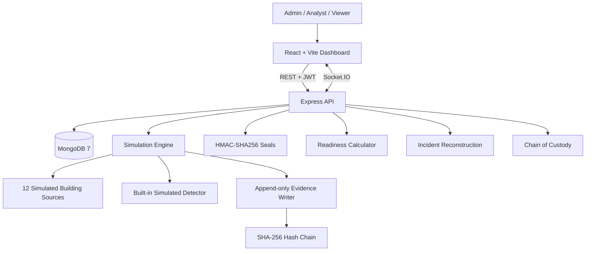

# Smart Building Digital Forensic Readiness Framework

**Team 3081 · Deployment-ready research prototype**

This repository combines a React dashboard, Node.js/Express API, MongoDB persistence, Socket.IO updates, simulated smart-building event generation, hash-chained evidence, HMAC seals, simulated attacker operations, readiness scoring and incident reconstruction.

> **Simulation notice:** this is a research prototype. It does not connect to live building devices, CCTV, HVAC controllers, fire panels, meters or production networks. All devices, events, incidents and attacker actions generated by the application are simulated. The detector is a built-in simulated detector; the supplied ML notebooks are retained as research assets and are not automatically loaded as a production inference service.

## Quick start with Docker (recommended)

1. Install Docker Desktop and VS Code.
2. Extract this ZIP and open the `smart-building-deploy` folder in VS Code.
3. Copy `.env.example` to `.env`.
4. Change all JWT, HMAC and seed-user passwords in `.env` before use.
5. In the VS Code terminal run:

```bash
docker compose up --build
```

6. Open the dashboard at **http://localhost:8080**. The API health endpoint is **http://localhost:5000/api/health**.

The backend seeds users, default settings and the 12 source definitions when the container starts. Default usernames/passwords are whatever you set in `.env`; change them before sharing or deploying the system.

To stop:

```bash
docker compose down
```

To stop and remove the MongoDB data volume as well:

```bash
docker compose down -v
```

## Run locally without Docker

Requirements: Node.js 20+, MongoDB 7 running locally.

```bash
cp .env.example .env
# Edit MONGO_URI to mongodb://127.0.0.1:27017/smart-building
cd backend && npm install && npm run seed && npm start
```

In a second terminal:

```bash
cd frontend
npm install
npm run dev
```

For local Vite development, create `frontend/.env.local` with:

```env
VITE_API_URL=http://localhost:5000/api
VITE_SOCKET_URL=http://localhost:5000
```

Vite normally serves the UI on http://localhost:5173. Add that origin to `CORS_ORIGIN` in the root `.env` (comma-separated if more than one origin).

## Seeded roles

The seed script reads credentials from environment variables. It creates these roles when their email/password variables are set:

- `admin`: system configuration, user management, simulation controls, seals, exports and attacker simulation.
- `analyst`: read access, integrity verification and incident reconstruction.
- `viewer`: read-only access.

No seed password is hard-coded in source code.

## Main dashboard pages

- **Overview:** simulation controls, scenario injection, evidence feed and readiness KPI.
- **Alerts:** detector alert records.
- **Integrity & Custody:** verification, HMAC checkpoint creation, seal listing and simulation-only attacker panel.
- **Investigation:** incident reconstruction and event timeline.
- **Readiness:** readiness score components, recommendations and editable weights.
- **Users:** admin-only user creation/listing.
- **Results:** research results copied from the supplied project README and explicitly labelled “verify before presenting”.

## Integrity model

Evidence uses the documented canonical body:

`[i, t.toFixed(1), source, kind, msg, incident ?? '', ev ?? '', conf ?? '', prev].join('|')`

The SHA-256 digest is stored in `hash`; the first previous hash is 64 zeroes. HMAC-SHA256 seals sign `${n}|${head}|${t}`. The HMAC key is read from `HMAC_SECRET`; it is not stored in MongoDB and is excluded from export responses.

The evidence collection is append-only through the normal API. The simulated attacker endpoints intentionally modify MongoDB directly and are disabled when `NODE_ENV=production`.

**Deployment note:** evidence appends are serialized within one Node process and protected by a unique sequence index. For multiple backend replicas or high-assurance production operation, replace the process-local append queue with a MongoDB transaction-backed writer using a replica set, plus external immutable/WORM storage and managed signing keys (KMS/HSM). This prototype is intended for demonstration and evaluation, not as a certified forensic evidence platform.

## API overview

Base URL: `/api`

| Method | Endpoint | Access | Purpose |
|---|---|---|---|
| POST | `/auth/login` | Public | Login and JWT |
| GET | `/auth/me` | Authenticated | Current user |
| GET/POST | `/users` | Admin | List/create users |
| GET/PUT | `/settings` | Authenticated/Admin | Read/update settings |
| GET | `/sources` | Authenticated | Source list |
| GET | `/simulation/status` | Authenticated | Simulation status |
| POST | `/simulation/start` | Admin | Start simulation |
| POST | `/simulation/pause` | Admin | Pause simulation |
| POST | `/simulation/reset` | Admin | Reset simulation clock |
| PUT | `/simulation/speed` | Admin | Set 1x, 5x or 20x |
| GET/POST | `/incidents` and `/incidents/inject` | Authenticated/Admin | List/inject scenarios S1–S6 |
| GET | `/evidence` | Authenticated | Paginated evidence |
| GET | `/evidence/:id` | Authenticated | Evidence detail by Mongo ID or sequence |
| GET | `/alerts` | Authenticated | Alert records |
| POST | `/integrity/verify` | Admin/Analyst | Verify chain and seals |
| POST | `/integrity/seal` | Admin | Create HMAC seal |
| GET | `/integrity/seals` | Authenticated | List seals (no signatures) |
| GET | `/integrity/export` | Admin | JSON evidence bundle |
| PATCH/DELETE | `/attacker/*` | Admin, simulation only | Simulate tampering |
| GET | `/custody` | Authenticated | Custody records |
| GET | `/custody/verify` | Admin/Analyst | Verify custody chain |
| GET | `/readiness/current` | Authenticated | Calculate/store FRS |
| GET | `/readiness/history` | Authenticated | Snapshot history |
| PUT | `/readiness/weights` | Admin | Update weights |
| POST | `/investigation/reconstruct` | Admin/Analyst | Reconstruct incident |
| GET | `/investigation` | Admin/Analyst | Reconstruction history |
| GET | `/results` | Authenticated | Static project results |

Socket.IO emits `evidence:new`, `alert:new`, `simulation:status` and `integrity:verified` events.

## Tests

```bash
cd backend
npm install
npm test
npm run test:coverage
```

Jest/Supertest tests use `mongodb-memory-server`; the first test run may download a MongoDB binary. Ensure internet access is available for that first run. The current test suite includes canonical hashing tests and API health/login integration tests. Expand it with the complete acceptance matrix before claiming production-grade verification.

## Research assets included

`project-assets/` preserves the original project ZIP contents:

- Poster PDF.
- `ML_Model_2.ipynb`.
- `ML_model3.ipynb`.
- Original project README.

The notebook results are not silently treated as live model predictions. The results page uses the summary metrics reported in the supplied README and marks them for verification before presentation.

## Architecture



## Known limitations

1. No live device integration is implemented.
2. The backend detector is simulated. The notebooks are included for research reproducibility but are not deployed as an inference endpoint.
3. The current readiness timing approximation should be replaced with a numerically precise error-function implementation before formal reporting.
4. Evidence append serialization is process-local; multi-replica deployment requires a transactional writer and replica-set MongoDB.
5. Simulation scheduling is in-process. Restart recovery of partially processed incidents is limited to stored per-event offsets; multi-instance scheduling is not coordinated.
6. The reconstruction service is a demonstrator. Its status logic should be extended to evaluate per-record chain validity and sealed-checkpoint coverage for each event, rather than relying only on the overall chain result.
7. The UI is a functional prototype; audit-grade exports, comprehensive user CRUD, source-level controls and full pagination/filter UX remain suitable next enhancements.
8. Run the complete test suite against the exact deployment environment before evaluation.

## Manual evaluator demo

1. Sign in using the admin credentials configured in `.env`.
2. Confirm the **SIMULATED BUILDING** label.
3. Start the simulation and observe the evidence feed.
4. Inject **S5 – Fire-alarm tampering**.
5. Let simulated time advance beyond the scenario offsets (use 20x speed to accelerate), then pause.
6. Open Integrity & Custody and verify the evidence chain.
7. Create a signed seal and verify again.
8. Use the attacker panel to edit or delete a record; verify again and observe the failure findings.
9. Open Investigation, select the injected incident and reconstruct its timeline.
10. Export the evidence bundle and confirm that the HMAC secret is not present.
11. Open Readiness and explain coverage, availability, integrity and timing components.

---

**Research disclaimer:** this repository is a deployable prototype to support academic demonstration. Do not use it as the sole source of evidence for legal proceedings or as a production building-security control.
